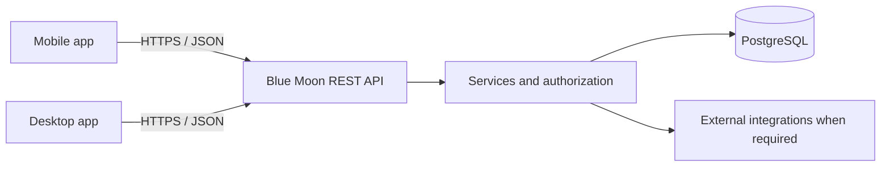

# Blue Moon — Lộ trình học và hoàn thiện backend cho mobile và desktop

Cập nhật ngày 21/10/2026 theo mục tiêu người học xác nhận: tự hoàn thiện phần backend của Blue Moon, phục vụ cả app mobile và app desktop, thời gian còn khoảng 3 tháng. Thông tin trước đó: nhóm có 2 người backend. Lịch 12 tuần bên dưới là kế hoạch tương đối; chưa có ngày nộp chính xác, số giờ mỗi tuần hoặc năng lực người backend còn lại.

Nguồn nghiệp vụ mới nhất đã đọc: [sổ quyết định KTPM](/home/ngocnguyen/Documents/2026.1/KTPM/Hoc_tap/SO_THEO_DOI_PROJECT.md), [README ERD](/home/ngocnguyen/Documents/2026.1/KTPM/Hoc_tap/ERD_BlueMoon/README.md) và [mô hình ERD](/home/ngocnguyen/Documents/2026.1/KTPM/Hoc_tap/ERD_BlueMoon/model.json), cập nhật 20/10/2026. ERD gồm 39 thực thể và cả tính năng mở rộng; có sơ đồ không đồng nghĩa đã có schema/code hoặc tất cả đều thuộc bản bắt buộc. Chưa đọc lại Google Sheet trực tiếp trong lượt lập lộ trình này.

`KTPM/blue-moon-demo` là website tham khảo React/TypeScript + Express + Prisma + PostgreSQL. Ba vai trò, quy tắc công nợ theo hộ và kết quả test của demo không thay thế quyết định Blue Moon mới. Định hướng backend Node.js + TypeScript + Express được người học nhắc lại; sổ KTPM còn ghi ưu tiên Prisma/PostgreSQL. Framework mobile/desktop và việc phân vai theo từng app chưa được xác nhận.

## 0. Đích hoàn thành và cách hai app dùng backend

Đích học là người học tự giải thích, viết, kiểm thử, tích hợp và triển khai được backend của các chức năng Blue Moon đã chốt. Những việc backend phải cung cấp:

- API chung, dữ liệu chung và quy tắc nghiệp vụ thống nhất cho hai app.
- Đăng nhập, đăng xuất, hết hạn/thu hồi phiên và quyền trên từng căn/tài nguyên.
- Các module căn hộ/cư trú, phí/hóa đơn/thanh toán, thông báo/phản ánh, bãi xe và kỹ thuật theo phạm vi đã thống nhất; module mở rộng theo ưu tiên.
- Test tự động, migration, tài liệu API, dữ liệu demo, log và hướng dẫn triển khai/khôi phục.
- Bằng chứng hai app gọi được backend đã triển khai và hoàn thành các luồng được phân công cho từng app.

Kiến trúc đề xuất ban đầu:

Hai app gọi cùng backend; không kết nối trực tiếp database. Backend kiểm tra quyền theo người đăng nhập, không theo tên app hay việc giao diện có ẩn nút. Mobile và desktop có thể được phân công chức năng khác nhau, nhưng cần thống nhất contract và cách hiểu trạng thái. Chưa mặc định mobile chỉ dành cho chủ nhà hoặc desktop chỉ dành cho Admin.

Lộ trình là học và làm song song: hoàn thành phần HTTP đang học, học TypeScript vừa đủ, sau đó áp dụng trên Blue Moon. Kiểm thử database, transaction và concurrency được bổ sung cùng module thực tế; không yêu cầu học xong toàn bộ các chương test mini-shop rồi mới bắt đầu project.

## 1. Điểm xuất phát

- Đã học JavaScript, async/await, HTTP, Express, CRUD, PostgreSQL, JOIN, SQL tham số hóa, validation, controller/service, middleware và transaction.
- Đã tự viết service tạo/đọc đơn, snapshots/tổng tiền, policy và service chuyển trạng thái; đã thực hành commit/rollback. Chi tiết và bằng chứng theo [LEARNING_PROGRESS.md](LEARNING_PROGRESS.md).
- Đã hoàn thành 14 test policy và 5 test service với pool giả; lần chạy chung trước đó ghi nhận 19 pass. Chưa lấy kết quả này làm bằng chứng SQL thật, persistence hay concurrency thật.
- Chương hiện tại: tách app factory nhận pool khỏi startup, rồi test HTTP Express bằng node:test/native fetch và listener tạm với pool giả. Chưa đánh dấu app factory hay chương HTTP hoàn thành khi chưa review bài người học.
- Lab vẫn dùng mini_shop_relations_lab; API sản phẩm dùng mini_shop. Blue Moon sẽ có project/database riêng khi bắt đầu triển khai theo yêu cầu, không đổi database hay tạo project trong lượt ghi lộ trình.

## 2. Stack đề xuất

| Thành phần | Đề xuất | Vai trò / thời điểm |
|---|---|---|
| Runtime | Node.js bản LTS còn được hỗ trợ | Dùng cùng major version trong nhóm và môi trường deploy |
| HTTP | Express 5, REST API | Tiếp nối kiến thức hiện tại |
| Ngôn ngữ | TypeScript theo định hướng nhóm | Học type/interface, union, narrowing, async return types, strict, build rồi áp dụng; không cần học toàn bộ TypeScript trước |
| Database | PostgreSQL | Quan hệ, lịch sử, hóa đơn, ràng buộc và transaction |
| DB access | Prisma theo định hướng đã ghi trong KTPM | Học schema, migration, truy vấn và transaction; giữ hiểu biết SQL từ pg trong lab; không tự đổi sang công cụ khác |
| Validation | Thư viện runtime validation, Zod là đề xuất | Kiểm tra dữ liệu request; TypeScript không thay thế việc này |
| Authentication | Chốt cơ chế phiên/token sau khi xác định hai client | Backend có thể thu hồi, hết hạn và quản lý nhiều phiên; cách lưu/gửi credential phù hợp nền tảng; không mặc định sao chép cookie của website demo |
| API contract | OpenAPI + ví dụ request/response | Frontend và backend thống nhất trước khi làm độc lập |
| Verification | node:test + HTTP/database integration tests | Bắt đầu cùng module đầu tiên, tăng ca kiểm thử theo nghiệp vụ |
| Deployment | CI, HTTPS, PostgreSQL, migration, log, backup | Deploy thử từ bản nhỏ; Docker Compose là lựa chọn hỗ trợ môi trường chung |

Kiến trúc ban đầu: một ứng dụng backend chia module nghiệp vụ, một database quan hệ; route → middleware → controller → service → Prisma/SQL. Service không phụ thuộc req/res. Các thao tác trong một transaction phải dùng cùng transaction context/client, kể cả khi tách repository. Bản đầu ưu tiên một ứng dụng dễ triển khai; chỉ thêm queue/Redis khi có nhu cầu cụ thể.

Giữ Express + TypeScript theo định hướng hiện tại. Không đưa việc học NestJS hoặc đổi framework thành điều kiện hoàn thành Blue Moon. Prisma là định hướng đã ghi trong KTPM, không phải bằng chứng người học đã học hoặc triển khai nó.

## 3. Những điều phải chốt trước ERD/API

Đã có căn cứ trong sổ KTPM, không hỏi lại như thông tin chưa biết:

- Sáu role: ADMIN, HOMEOWNER, HR_MANAGER, BUSINESS_OPERATOR, TECHNICIAN, SECURITY. Mỗi UserAccount có đúng một Role; System không có tài khoản.
- Một chủ nhà có thể quản lý nhiều căn; mỗi căn tối đa một lần gán chủ đang hiệu lực. Chủ cũ mất quyền xem căn đã chuyển, kể cả lịch sử; chủ mới nhận quyền xem dữ liệu căn. Cư trú được quản lý riêng và có lịch sử.
- Cho phép một giao dịch trả nhiều hóa đơn và thanh toán một phần. Có PaymentAllocation; chỉ giao dịch thành công giảm công nợ. Quyền xem giao dịch nhiều căn phải lọc từng phần thuộc phạm vi hiện tại.
- ERD đã có phương án đăng ký gửi xe, vé tháng/vé lượt, lượt gửi và vị trí đỗ. Một xe tối đa một lượt đang mở; lượt chưa gán ô vẫn chiếm sức chứa.

Cần làm rõ trước từng phần phụ thuộc, không chặn việc ghi lộ trình:

1. Framework và hệ điều hành mobile/desktop; chức năng, actor của từng app; có cần dùng offline hay không.
2. Repo chính thức, giờ làm/tuần, phân công hai người backend; ngày nộp chính xác khi có.
3. Feature list/User stories mới nhất và mức bắt buộc; ERD có cả phần mở rộng nên không suy ra tất cả thuộc bản đầu.
4. Biểu phí, kỳ/hạn thanh toán, làm tròn, quy trình phát hành/hủy/điều chỉnh; các trường hợp chuyển căn/chủ giữa kỳ.
5. Cổng thanh toán cụ thể, sandbox hay ghi nhận thủ công; tài liệu, credential và callback môi trường thử. Không tự coi VNPAY của demo là lựa chọn mới đã chốt.
6. Thiết bị bãi xe/kỹ thuật thật hay nhập tay/mô phỏng; kênh thông báo trong app, email hoặc push.

Ghi ví dụ và ma trận actor–action–resource cho mỗi quyết định. Không lấy việc mở app desktop hoặc mobile làm quyền truy cập.

## 4. Thứ tự học và làm

Mỗi chặng có thể gồm nhiều buổi/chat nhỏ. Kiểm thử, tài liệu API và triển khai thử được làm xuyên suốt; chặng 12 là mốc hoàn thiện, không phải đợi đến đó mới bắt đầu.

### Cầu nối hiện tại — Hoàn thành chương HTTP của mini-shop

- Tự tách createOrderApp(pool) khỏi pg.Pool/listen; giữ nguyên routes/error middleware và startup 3001 của lab.
- Tự viết test với node:test/native fetch, listener tạm và cleanup; mỗi lần một ca: controller từ chối ID/body sai, parser từ chối JSON hỏng/body quá lớn, service trả lỗi qua middleware, thành công trả đúng status/JSON, lỗi bất ngờ thành 500.
- Chọn ca đủ phủ các lớp và rủi ro, không dùng số lượng test làm mục tiêu. Pool giả phải được kiểm soát để phát hiện gọi DB ngoài dự kiến.
- Đạt khi: tự giải thích request đi qua đâu, test dùng pool nào, vì sao import app không mở cổng và vì sao listener/pool cần được dọn. Qua HTTP thật với pool giả vẫn chưa kiểm chứng PostgreSQL.
- Sau chương: chuyển vào các chặng Blue Moon dưới đây. Test SQL/persistence/rollback/concurrency sẽ được dạy trên module dự án tương ứng.

### Chặng 1 — Phân tích nghiệp vụ

- Học: use case, actor, luồng thành công/thất bại, trạng thái và chuyển trạng thái, invariant (điều kiện hệ thống phải luôn giữ đúng).
- Áp dụng: đọc lại feature list/user stories và ERD đã có; phân biệt quyền vai trò và quyền đối với căn hộ cụ thể; gắn chức năng với mobile/desktop mà nhóm thực sự chọn.
- Đầu ra: glossary, ma trận quyền, danh sách Must have/Nice to have, phân công chức năng hai app, sơ đồ trạng thái hóa đơn/phản ánh/xe vào ra.
- Đạt khi: nhóm trả lời được ai làm gì, với dữ liệu nào, trường hợp nào bị từ chối.

### Chặng 2 — Nền project nhóm và TypeScript

- Học: type/interface, optional/null, union trạng thái, narrowing, Promise<T>, strict, unknown/error, build; runtime validation; cấu trúc module, dependency, cấu hình môi trường.
- Áp dụng: chuyển một policy/service quen thuộc thành TypeScript trước; sau đó dựng nền Blue Moon với app factory, route/controller/service, lỗi thống nhất, request ID và log. Git branch/PR, review/merge/conflict, lint/format, lockfile, build và OpenAPI cơ bản.
- Đầu ra: server khởi động, health endpoint, config validation, một API đọc mẫu, test đầu tiên, CI build/typecheck/test và bản deploy thử. Hai đội client có base URL và ví dụ JSON để ghép sớm.
- Đạt khi: máy thành viên khác chạy từ README; không cần chia sẻ .env thật. TypeScript không dùng any cho toàn bộ dữ liệu DB/request.

### Chặng 3 — Thiết kế DB, migration và truy vấn

- Học: ERD, khóa ngoại, unique/check/not-null, bảng liên kết, index, migration/seed, tổng hợp GROUP BY, ngày giờ và khoảng thời gian hiệu lực.
- Áp dụng: chuyển phần ERD cần cho lát cắt đầu tiên thành Prisma schema: UserAccount, Role, Permission, Apartment, OwnershipAssignment, Resident, Residency. Không chuyển máy móc cả 39 thực thể thành bảng cùng lúc; ghi chú cardinality/hiệu lực mà schema phải bảo vệ.
- Đầu ra: database rỗng dựng được bằng migration, seed hư cấu lặp lại an toàn, truy vấn căn hộ và lịch sử; database/schema kiểm thử riêng.
- Test: tạo dữ liệu fixture biết trước, gọi API thật với PostgreSQL thật, đọc lại để kiểm chứng; dọn đúng dữ liệu test. Transaction rollback bên ngoài test không tự hoàn tác các request dùng kết nối khác.
- Đạt khi: không trùng định danh căn trong cùng phạm vi; quan hệ người–căn có lịch sử; constraint thực sự được kiểm thử; không xóa cascade mất hóa đơn/lịch sử. Không cần database của demo cũ để chạy.

### Chặng 4 — Đăng nhập, đăng xuất cho hai loại client

- Học: băm/kiểm tra mật khẩu, phiên đăng nhập, hết hạn/thu hồi, nhiều thiết bị, rate limit đăng nhập và thông báo lỗi phù hợp. Dùng thư viện băm mật khẩu chuyên dụng theo [OWASP Password Storage](https://cheatsheetseries.owasp.org/cheatsheets/Password_Storage_Cheat_Sheet.html).
- Chốt cơ chế sau khi biết client: phiên cookie với cookie jar/CSRF phù hợp, hoặc token theo thiết kế được review. Nếu dùng access/refresh token, xác định thời hạn, rotation/thu hồi và hành vi logout; JWT không tự cung cấp tất cả các cơ chế này.
- Phân định trách nhiệm: backend xác thực và quản lý phiên; app lưu credential bằng cơ chế an toàn của nền tảng. Không nhúng DB password hay một shared secret đáng tin cậy vào app phát hành.
- Đầu ra: login, logout, me; quy tắc khóa/đổi mật khẩu; contract xử lý 401 và hết hạn. Chưa tự thêm đăng ký công khai nếu yêu cầu không có.
- Đạt khi: đăng nhập từ cả hai loại client đã chốt; hết hạn/khóa/thu hồi có hiệu lực đúng thiết kế; mật khẩu/credential không xuất hiện trong response hoặc log. Quên mật khẩu có token một lần, hết hạn và kênh gửi được kiểm chứng khi thuộc scope.
- Nếu nhóm chọn OAuth/OIDC: dùng luồng phù hợp native app và PKCE, không tự biến login mật khẩu nội bộ thành bài phải dựng OAuth server. Tham khảo [RFC 8252](https://www.rfc-editor.org/rfc/rfc8252) và [RFC 9700](https://www.rfc-editor.org/rfc/rfc9700).

### Chặng 5 — Phân quyền vai trò và phạm vi dữ liệu

- Học: authentication khác authorization; RBAC; kiểm tra quan hệ tài khoản–người–căn/tòa; phòng truy cập dữ liệu bằng cách đổi ID.
- Áp dụng: sáu role trong sổ KTPM, mỗi tài khoản một role; không tự thêm role Accountant từ website demo. Kiểm tra phạm vi căn hiện được gán, không dùng lịch sử tạo bản ghi làm quyền.
- Đầu ra: middleware xác thực; policy trong service/truy vấn; test với tài khoản A/B khác căn.
- Đạt khi: A không đọc/sửa hóa đơn, cư dân, xe hoặc phản ánh của B bằng cách đổi ID. Danh tính lấy từ credential đã xác thực, không tin userId trong body. Chuyển chủ xong chủ cũ mất quyền với căn, kể cả lịch sử; chủ mới thấy đúng phạm vi. Giao dịch nhiều căn không lộ phân bổ căn khác. Đây là bước mở rộng ý tưởng addressId phải thuộc customerId đã học.

### Chặng 6 — Căn hộ, hộ dân cư và lịch sử

- Học: quan hệ nhiều–nhiều có thời gian, transaction nhiều bảng, quy trình cập nhật/duyệt, tránh ghi đè thay đổi đồng thời.
- Áp dụng: gán/chuyển tài khoản chủ nhà, hồ sơ cư dân, chuyển đến/đi, trạng thái căn hộ. Chuyển chủ và chuyển cư trú là hai nghiệp vụ riêng.
- Đầu ra: tạo/cập nhật hồ sơ, kết thúc/tạo OwnershipAssignment và Residency đúng hiệu lực; phân trang/tìm kiếm/lọc phù hợp. Mobile/desktop dùng chung định danh và quy tắc.
- Test: kết thúc lần gán cũ rồi gặp lỗi trước lần gán mới phải rollback cả thao tác; hai lần gán đồng thời không tạo hai chủ hiện tại. Học DB transaction/concurrency cùng chức năng này.
- Đạt khi: chuyển người ở không mất lịch sử, chuyển chủ không tự đổi người ở; chỉ dữ liệu thuộc quyền được sửa; các thay đổi liên quan cùng thành công hoặc cùng rollback.

### Chặng 7 — Chỉ số điện nước, biểu phí, hóa đơn và công nợ

- Học: kỳ hóa đơn, NUMERIC/số nguyên tiền VND với giới hạn rõ, đơn vị và quy tắc làm tròn; transaction; chống phát hành trùng; lưu snapshot giá; tổng hợp công nợ.
- Áp dụng: chỉ số điện/nước từng căn, phí tòa nhà và công nợ. Tiền thuê/sửa chữa có thể dùng chung cơ chế dòng hóa đơn ở chặng mở rộng.
- Đầu ra: UtilityReading, FeeType, FeeRate, Invoice, InvoiceItem theo ERD; lập hóa đơn theo kỳ, tổng hợp số đã trả/còn nợ theo căn và kỳ. Chưa thêm quản lý từng đồng hồ/thay đồng hồ vì mô hình hiện tại chưa có yêu cầu đó.
- Test: fixture tính tiền bằng tay, biên kỳ, thiếu/sai chỉ số, phát hành lặp, rollback khi lỗi giữa các dòng; đọc DB sau request. API truyền tiền/decimal theo contract để hai client không tự làm tròn khác nhau.
- Đạt khi: giữ được lịch sử biểu giá; chỉ số sai bị chặn; gọi tạo cùng kỳ hai lần không sinh hóa đơn trùng; tiền do backend tính. Số lượng đo lẻ phải dùng độ chính xác phù hợp, không ép mọi giá trị về integer. Hóa đơn thuộc Apartment hoặc Lease theo loại, không bắt thuộc cả hai.
- Ví dụ: chỉ số cuối 125, đầu 100 → tiêu thụ 25 đơn vị; kết quả tiền theo biểu giá nhóm đã chốt.

### Chặng 8 — Thanh toán, đối soát và xử lý đồng thời

- Học: payment khác invoice; trạng thái thanh toán; idempotency (gửi lặp vẫn một kết quả nghiệp vụ); unique external reference; khóa hàng/cập nhật có điều kiện; callback/webhook và xác minh nguồn; retry có kiểm soát.
- Áp dụng: một giao dịch trả nhiều hóa đơn và trả một phần theo quyết định KTPM. Người trả chỉ định phân bổ; tổng phân bổ bằng số tiền giao dịch, không vượt nợ. Giao dịch chờ có cơ chế giữ khoản dự kiến, thất bại/hết hạn giải phóng; chưa giảm công nợ trước thành công.
- Đầu ra: Payment, PaymentAllocation, vòng đời xử lý và audit; xác nhận thành công/cập nhật phân bổ nhất quán. Khi gọi nhà cung cấp, không giữ transaction DB mở để chờ phản hồi mạng; thiết kế các bước giữ khoản, gọi ngoài và xác nhận riêng.
- Test: hai kết nối/request cạnh tranh có phối hợp thời điểm để kiểm tra giữ khoản; callback/gửi lại do timeout; lỗi giữa chừng; giao dịch qua chuyển chủ; lọc quyền xem từng phân bổ. Dùng barrier/điểm đồng bộ, không coi Promise.all đơn thuần hay sleep là bằng chứng chắc chắn đã tranh chấp.
- Đạt khi: hai client hoặc callback trùng không ghi nhận tiền hai lần; return URL trên app không tự làm hóa đơn paid; chỉ xác nhận đáng tin cậy từ server/provider theo thiết kế mới cập nhật. Phương thức thanh toán và quy tắc hoàn/hủy phải chốt trước. [PostgreSQL transaction isolation](https://www.postgresql.org/docs/current/transaction-iso.html) là tài liệu cho phần tranh chấp dữ liệu.

### Chặng 9 — Thông báo, nhắc hạn, phản ánh

- Học: phân phối thông báo theo đối tượng, read/unread; công việc định kỳ; retry/chống gửi trùng; trạng thái nghiệp vụ; upload an toàn nếu có ảnh; audit log.
- Áp dụng: Announcement, Alert, ServiceRequest, RequestHistory; gửi phản ánh và người có quyền tiếp nhận/xử lý.
- Đầu ra: danh sách thông báo/cảnh báo qua API chung; job nhắc hạn lặp an toàn; trạng thái gửi/đọc Alert theo từng người nhận. ERD hiện chưa có read/unread theo người cho Announcement, không tự coi đã hỗ trợ. Email/SMS/push là tích hợp theo scope.
- Đạt khi: đúng người nhận đúng dữ liệu; nhắc hạn không gửi trùng vô hạn; theo dõi phản ánh đúng quyền. Không gửi email khi giữ transaction thanh toán mở; có bản ghi công việc chờ gửi sau commit và retry.
- Hai client: bản đầu có thể tải lại danh sách khi mở app; chỉ thêm push/WebSocket khi yêu cầu cần. Gửi push thành công tới provider, giao đến thiết bị và người dùng đã đọc là các bằng chứng khác nhau. Upload ảnh chỉ thêm khi phản ánh có yêu cầu đính kèm.

### Chặng 10 — Bãi xe và kỹ thuật tòa nhà

- Học: event vào/ra, state machine, transaction/cạnh tranh cập nhật, truy vấn sức chứa; asset/status history, thời điểm/nguồn trạng thái.
- Áp dụng bắt buộc theo ảnh: xe vào/ra, vé tháng/vé lượt, số chỗ trống từng hầm; tình trạng điện từng tầng.
- Đầu ra: ParkingRegistration, MonthlyPass, Vehicle, ParkingSession, ParkingArea, ParkingSpace, ParkingSpaceUsage; Facility và FacilityStatusHistory theo ERD. Phương án nhập tay/mô phỏng cần được nhóm xác nhận nếu chưa có tích hợp thật.
- Đạt khi: xe không có hai lượt đang mở; request trùng không tạo hai lượt; chỗ trống không âm; hai thao tác đồng thời không vượt sức chứa; một ô không bị hai xe chiếm. Lượt chưa gán ô vẫn chiếm sức chứa. Phí vé tháng tái dùng hóa đơn; không tự khóa vé do trả một phần khi quyết định hiện tại chưa yêu cầu.
- Mở rộng: map ô đỗ khi đã có dữ liệu từng ô; trạng thái/cảnh báo thang máy và báo cháy. Ứng dụng ghi nhận/truyền sự kiện theo tích hợp được thống nhất; điều khiển thiết bị và hệ thống báo cháy chuyên dụng là một phạm vi riêng cần đặc tả.

### Chặng 11 — Các module mở rộng trong ảnh

- Quên mật khẩu: token một lần, thời hạn, gửi mail, chống dò tài khoản.
- Phí sửa chữa: phiếu việc/chi phí → dòng hóa đơn → dùng luồng thanh toán chung.
- Hộ kinh doanh: hợp đồng thuê, kỳ thuê, phí định kỳ, đơn xin phép và quy trình duyệt.
- Nhân sự: nhân viên/vai trò công việc, ca trực, lịch phân công, kiểm tra ca trùng.
- Khách ra/vào: đăng ký khách, người bảo lãnh/căn hộ, check-in/out, phạm vi xem dữ liệu.
- Đạt khi: mỗi module bổ sung dùng lại auth/quyền/thanh toán/thông báo sẵn có, có trạng thái và quyền rõ ràng. Chỉ triển khai sau phần bắt buộc hoặc theo phân công độc lập đã thống nhất.

### Chặng 12 — Hoàn thiện kiểm thử và triển khai

- Học/làm xuyên suốt: unit test logic tiền/trạng thái, integration HTTP+PostgreSQL, kiểm tra phân quyền, transaction và gọi lặp/đồng thời; CI, môi trường test riêng, seed demo, OpenAPI.
- Vận hành: HTTPS, auth/cookie/CORS/CSRF theo loại client và cách host, giới hạn request/upload, che dữ liệu nhạy cảm trong log, health/readiness, shutdown trả kết nối, migration deploy, backup và thử restore. Docker/Compose là công cụ chuẩn hóa môi trường nếu cần; không phải mục tiêu thay cho nghiệp vụ.
- Tích hợp hai app: base URL cấu hình được, ID/tiền/ngày giờ/phân trang/error code nhất quán; xử lý mất mạng, timeout, gửi lại và phiên hết hạn. App thật trên điện thoại/máy khác cần truy cập được host backend; localhost trên từng thiết bị không tự chỉ về máy lập trình.
- CORS do browser thực thi, không phải cơ chế phân quyền API; desktop WebView và native HTTP có thể khác nhau. Cấu hình sau khi biết framework, theo [Express CORS](https://expressjs.com/en/resources/middleware/cors/).
- Đạt khi: nhóm dựng được từ repo, demo từ DB sạch, giữ được dữ liệu sau restart/redeploy; có log truy lỗi và restore đã thử. Mỗi luồng quan trọng có test đúng tầng và bằng chứng chạy từ hai app theo chức năng được phân công; chưa lấy Postman thay cho nghiệm thu app thật.

## 5. Đối chiếu tính năng đã lưu

Giữ nguyên mức ưu tiên đã ghi từ ảnh ngày 18/10. Bảng này là bản đối chiếu đã lưu, chưa phải xác nhận lại Feature list trên Google Sheet ngày 21/10. Nếu sheet mới có thay đổi, cập nhật theo sheet và quyết định nhóm; không tự hạ Must have thành Nice to have. Chi tiết quan hệ/quyền dùng sổ KTPM ngày 20/10.

| Tính năng | Ưu tiên ảnh | Chặng chính |
|---|---|---|
| Đăng nhập, đăng xuất | Must have | 4 |
| Quên mật khẩu | Nice to have | 11 |
| Phân quyền người dùng | Must have | 5 |
| Cập nhật hộ dân cư; trạng thái mua nhà | Must have | 6 |
| Chỉ số điện nước từng nhà | Must have | 7 |
| Tình trạng điện từng tầng | Must have | 10 |
| Tình trạng thang máy; tình trạng báo cháy | Nice to have | 10 mở rộng |
| Map trạng thái ô đỗ | Nice to have | 10 mở rộng |
| Số chỗ trống từng hầm; xe vào/ra và vé tháng/vé lượt | Must have | 10 |
| Theo dõi công nợ | Must have | 7–8 |
| Thanh toán phí điện nước; phí tòa nhà | Must have | 7–8 |
| Thanh toán hóa đơn sửa chữa | Nice to have | 11, tái dùng 7–8 |
| Cảnh báo hạn thanh toán | Must have | 9 |
| Cảnh báo thang máy; cháy nhà | Nice to have | 10 mở rộng + 9 |
| Đăng/nhận thông báo | Must have | 9 |
| Quản lý ca bảo vệ, lễ tân, lao công | Nice to have | 11 |
| Phí thuê hàng tháng của hộ kinh doanh | Nice to have | 11, tái dùng 7–8 |
| Đơn xin phép online | Nice to have | 11 |
| Feedback/phản ánh; tiếp nhận/xử lý đơn | Must have | 9 |
| Quản lý khách ra/vào | Nice to have | 11 |

## 6. Các mốc giao bản đề xuất

1. **Lát cắt đầu tiên:** Admin tạo căn và gán tài khoản chủ nhà → chủ nhà đăng nhập → chỉ xem các căn hiện được gán. Có test A/B, test chuyển chủ, deploy thử và ghép hai client theo chức năng nhóm phân công.
2. **Nghiệp vụ tài chính:** nhập số điện nước → lập hóa đơn → chủ nhà xem công nợ → trả một phần/nhiều hóa đơn → xác nhận thanh toán → công nợ thay đổi đúng; có rollback và chống lặp.
3. **Giao tiếp:** thông báo, nhắc hạn, phản ánh và xử lý; kiểm tra người nhận/quyền.
4. **Đủ nhóm tính năng bắt buộc trong ảnh:** bãi xe, số chỗ trống và tình trạng điện; tích hợp và kiểm thử tổng thể các nhóm trên.
5. **Mở rộng:** các Nice to have theo thời gian còn lại và yêu cầu giảng viên/khách hàng.

Bản lát cắt đầu tiên là mốc nội bộ, chưa được coi là đã đáp ứng toàn bộ Must have. Tích hợp thanh toán/thiết bị thật có phụ thuộc tài khoản, sandbox, thiết bị, tài liệu và quyền truy cập; không suy ra đã được cung cấp.

## 7. Cách tiếp tục học

- Hoàn thành chương HTTP đang học bằng từng bài nhỏ. Sau đó học TypeScript vừa đủ và chuyển sang Blue Moon; không mở thêm chuỗi chương mini-shop như điều kiện bắt buộc trước dự án.
- Mỗi chương kiến thức mới dùng một chat riêng theo sở thích đã lưu. Trong chương, giải thích vấn đề → người học tự viết một phần chạy được → review → mở rộng.
- Bắt đầu phần Blue Moon bằng đọc quyết định/ERD đã có, chọn phần nhỏ để hiểu và chuyển thành schema/API; không bắt thiết kế lại từ đầu cả ERD. Chỉ tạo project/implementation khi người học yêu cầu; lượt hiện tại chỉ ghi lộ trình.
- Người học tự viết implementation/scaffold/tests; mentor hướng dẫn và review, không viết cả tính năng thay rồi lấy việc code chạy được làm bằng chứng người học hiểu. Giảng tiếng Việt; code comments/test names/messages mới bằng tiếng Anh. Manual HTTP dùng Postman.
- Điểm nối kiến thức: order/order_items → invoice/invoice_items; snapshot giá sản phẩm → snapshot biểu phí; address thuộc customer → invoice/căn thuộc quyền user; transaction tạo đơn → phát hành hóa đơn/ghi nhận thanh toán.

## 8. Kế hoạch tham khảo cho 2 người, khoảng 12 tuần

Mục tiêu là đến tuần 8 có toàn bộ luồng Must have chạy trên môi trường demo; tuần 9–12 dành cho nghiệm thu, mở rộng có chọn lọc, sửa lỗi và bàn giao. Khả năng thực hiện phụ thuộc thời lượng thực tế và tích hợp bên ngoài; đây là kế hoạch đề xuất, không phải cam kết hoàn thành. Học nền TypeScript/kiến trúc ngắn rồi áp dụng ngay, không học tuần tự cả 12 chặng rồi mới làm project.

Đề xuất hai người chia module, cùng giữ quy ước schema/API và review chéo:

- Backend A: xác thực/phân quyền và tài chính (điện nước, hóa đơn, thanh toán).
- Backend B: căn hộ/cư dân, thông báo/phản ánh, bãi xe và trạng thái kỹ thuật.
- Cả hai cùng review UserAccount–OwnershipAssignment–Apartment và Residency, làm test quyền/tích hợp; thống nhất migration trước khi merge. Tải việc cần điều chỉnh sau mỗi tuần; phân công này không bắt buộc theo tên người học. Vai trò phát triển Backend A/B không phải role người dùng của hệ thống.

| Tuần | Backend A | Backend B | Mốc chung |
|---|---|---|---|
| 1 | Hoàn thành cầu nối HTTP; học TypeScript vừa đủ; cùng chốt quyền/auth/API | Cùng đọc ERD, dựng nền project/migration/seed và môi trường chạy | Xác định framework/actor hai app; API mẫu, CI/deploy thử; kiểm tra nhu cầu tích hợp ngoài |
| 2 | Login/logout/me, cơ chế phiên đã chốt, policy nền | API căn hộ, liên kết UserAccount–Apartment | Chủ nhà xem đúng căn; mobile/desktop ghép health/login/luồng đọc được phân công |
| 3 | Hoàn thiện quyền theo đối tượng, test A/B/chuyển chủ; contract tài chính | Cư trú, chuyển đến/đi, chuyển chủ và trạng thái căn | Lát cắt đầu tiên chạy; test DB/rollback/quyền và tài liệu đi cùng |
| 4 | Chỉ số điện/nước, kỳ và biểu phí | Đăng/nhận thông báo; gửi/tiếp nhận phản ánh | Demo dữ liệu và API từng module |
| 5 | Hóa đơn, dòng hóa đơn, chống phát hành trùng, công nợ | Phản ánh hoàn chỉnh; xe/vé/bãi, sự kiện vào/ra | Hóa đơn đúng số liệu; phân quyền module B đầy đủ |
| 6 | Thanh toán nhiều hóa đơn/một phần, giữ khoản chờ, transaction/chống lặp | Sức chứa bãi xe, số chỗ trống; tình trạng điện từng tầng | Test cạnh tranh tài chính/bãi xe có kiểm soát; luồng chạy trên app tương ứng |
| 7 | Hoàn thiện sandbox nếu thuộc scope và đã có tài liệu/tài khoản; đối soát/test tài chính | Job nhắc hạn theo contract hóa đơn; hoàn thiện lịch sử/lỗi vận hành | Hai app tích hợp theo tính năng; không lấy ghi nhận thủ công thay nghiệm thu online |
| 8 | Cùng kiểm thử tài chính, quyền, gọi lặp/đồng thời và callback | Cùng kiểm thử vận hành, hai client và mất mạng/hết phiên | Mục tiêu toàn bộ Must have đã chốt chạy trên môi trường demo |
| 9 | Sửa lỗi nghiệm thu, dữ liệu lệch, quyền và hiệu năng truy vấn | Sửa lỗi nghiệm thu, trạng thái và luồng giao diện | Giữ hệ thống ổn định trước khi mở rộng |
| 10 | Chọn Nice to have nhỏ theo nhu cầu, ví dụ quên mật khẩu | Chọn Nice to have nhỏ, ví dụ phí sửa chữa tái dùng hóa đơn | Chỉ mở rộng khi phần bắt buộc đạt |
| 11 | Cùng khóa phạm vi, kiểm thử hồi quy, migration, backup/restore | Cùng hoàn thiện OpenAPI/README, seed và demo | Bản dự kiến bàn giao; ngừng thêm tính năng |
| 12 | Dự phòng lỗi, diễn tập deploy và hỗ trợ demo | Dự phòng lỗi, diễn tập demo và tài liệu | Bàn giao |

Quy tắc thực hiện:

- Merge và demo luồng liên module mỗi tuần, không đợi tuần cuối mới ghép. Mỗi module có test, tài liệu API và kiểm tra app liên quan cùng thời điểm viết. Nếu phát sinh quá nhiều việc học hoặc frontend chưa sẵn sàng, điều chỉnh tải và tiến độ thay vì mặc định lịch này vẫn khả thi.
- Các nhánh làm song song phải thống nhất contract trước: identity/quyền ở tuần 1–2; hóa đơn/công nợ cho job nhắc hạn trước tuần 7. Hai backend hỗ trợ chéo luồng trọng yếu; không đợi người phụ trách học xong toàn bộ mới cho module khác ghép API.
- Đề xuất baseline nhập tay/mô phỏng sự kiện bãi xe/thiết bị và ghi nhận thanh toán có người xác nhận. Nhóm chưa xác nhận baseline này. Nếu yêu cầu thật, cần chốt tài liệu, tài khoản sandbox, thiết bị và đầu mối tích hợp ngay tuần 1 rồi điều chỉnh lịch.
- Không coi thu tiền thủ công là thanh toán trực tuyến thật. Không tự đưa OCR biển số, điều khiển barie hoặc điều khiển báo cháy vào phạm vi.
- Mỗi tuần hoàn thành một lát cắt chạy được thay vì gom toàn bộ database rồi toàn bộ backend. Nếu tuần 3 chưa có luồng đăng nhập–căn hộ với quyền đúng, giảm phần mở rộng và xử lý vướng mắc trước.

## 9. Điều kiện nghiệm thu backend

### Contract và hai client

- OpenAPI và bộ request Postman mô tả method/path/body/status/error code/quyền; có ví dụ phân trang, số tiền và thời gian. Mỗi chức năng được gắn với user story/AC, API, test và bằng chứng demo.
- Chốt cách truyền ID, decimal/tiền VND, ngày nghiệp vụ và timestamp/múi giờ; hai client không tự tính tiền khác backend. Không tự trộn ngày đọc chỉ số với timestamp UTC.
- Framework mobile/desktop được xác nhận; mỗi app có cấu hình API URL, login/session lifecycle, loading/empty/error và xử lý timeout/retry. Không hứa đồng bộ offline trước khi có yêu cầu và thiết kế xung đột.
- Cùng một dữ liệu cập nhật từ app có quyền phải được app còn lại đọc thấy sau lần tải theo contract. Nếu yêu cầu cập nhật tức thì, định nghĩa độ trễ và cơ chế riêng; không mặc định mọi API phải realtime.

### Nghiệp vụ và kiểm thử

- Lát cắt căn hộ, hóa đơn/thanh toán, thông báo/phản ánh, bãi xe/kỹ thuật đều đạt AC của phần bắt buộc đã chốt.
- Có test logic thuần, HTTP với dependency giả, HTTP/database thật, quyền A/B và chuyển chủ; rollback/idempotency/concurrency ở các thao tác có rủi ro. Coverage hỗ trợ tìm lỗ hổng, không thay AC.
- Khi hai app gửi trùng/cạnh tranh hoặc callback đến muộn, dữ liệu vẫn giữ invariant. Trạng thái chờ/thất bại không tự biến thành thành công trên app.
- Mock/local/sandbox/provider thật được ghi rõ trong báo cáo. Kết quả test/demo tham khảo không phải kết quả project nhóm, cũng không chứng minh người học đã hiểu.

### Triển khai và bàn giao

- Repo mới clone chạy theo README; env.example chỉ chứa tên biến/giá trị mẫu; migration/seed có phiên bản. Production/test/demo được tách theo kế hoạch.
- CI chạy typecheck/build/tests cần thiết; PostgreSQL cho test được dựng và dọn đúng phạm vi. Học CI từ [GitHub Actions cho Node.js](https://docs.github.com/en/actions/tutorials/build-and-test-code/nodejs), điều chỉnh nếu nhóm dùng GitLab.
- Backend HTTPS truy cập được từ thiết bị thật; cấu hình môi trường đúng; log có request ID và không chứa credential. Kiểm tra lỗi bất ngờ, DB unavailable và shutdown theo nhu cầu vận hành.
- Dữ liệu giữ qua restart/redeploy; backup được restore thử trên môi trường khác. Có kịch bản demo, tài khoản/dữ liệu hư cấu, bảng known issues và hướng dẫn chuyển giao.
- Tài liệu môn học theo rubric/template khi được cung cấp; giải thích được lựa chọn quyền, snapshot, transaction, phân bổ tiền và cách kiểm chứng. Không đánh dấu mọi mục Done chỉ vì server khởi động được.

## 10. Tài liệu chính thức tham khảo

- [TypeScript Handbook](https://www.typescriptlang.org/docs/handbook/) và [strict](https://www.typescriptlang.org/tsconfig/strict): học kiểu/narrowing và kiểm tra kiểu khi build; validate dữ liệu runtime là bước riêng.
- [Node.js test runner](https://nodejs.org/api/test.html): test, lifecycle và cách chạy; đối chiếu phiên bản Node đang dùng trước khi lấy tùy chọn mới.
- [PostgreSQL transaction isolation](https://www.postgresql.org/docs/current/transaction-iso.html) và [locking](https://www.postgresql.org/docs/current/explicit-locking.html).
- [Express production security](https://expressjs.com/en/advanced/best-practice-security/) và [performance/reliability](https://expressjs.com/en/advanced/best-practice-performance/).
- [Express CORS](https://expressjs.com/en/resources/middleware/cors/) và [sessions](https://expressjs.com/en/resources/middleware/session/): áp dụng theo loại client/hosting đã chọn, không mặc định website demo đại diện cho app native.
- [OWASP Password Storage](https://cheatsheetseries.owasp.org/cheatsheets/Password_Storage_Cheat_Sheet.html).
- [RFC 8252 — OAuth for Native Apps](https://www.rfc-editor.org/rfc/rfc8252) và [RFC 9700 — OAuth Security](https://www.rfc-editor.org/rfc/rfc9700): dành cho trường hợp chọn OAuth/OIDC.
- [GitHub Actions — Node.js](https://docs.github.com/en/actions/tutorials/build-and-test-code/nodejs).

Phiên bản công cụ, hosting và tích hợp ngoài được kiểm tra lại khi bắt đầu phần triển khai tương ứng; lộ trình không khóa một gói dịch vụ trả phí hoặc tự cài thêm dependency.
