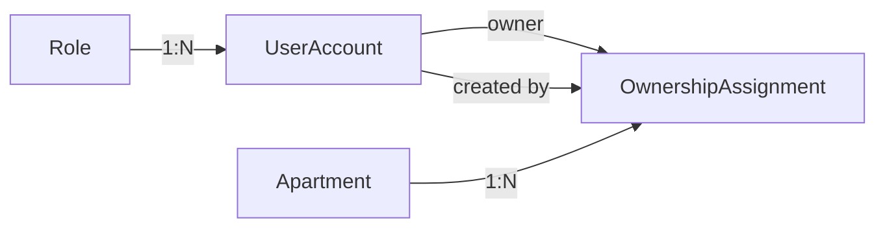
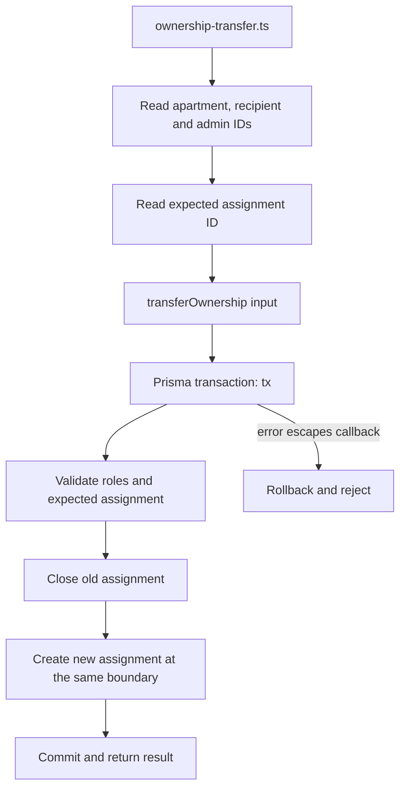

# Blue Moon — bắt đầu đọc project từ đây

Đọc [điểm dừng hiện tại](docs/CURRENT_STATE.md) trước khi tiếp tục làm việc. Tài liệu này giải thích cấu trúc và luồng; điểm dừng cho biết việc đang làm dở.

## Project hiện làm gì?

Đây là phần backend Blue Moon đang được xây từng bước bằng TypeScript, PostgreSQL và Prisma 7.10.1. Phần đã có: căn hộ, role, tài khoản ở mức thông tin cơ bản, lịch sử gán chủ, đọc căn hộ theo chủ hiện tại và service chuyển chủ bằng transaction.

Project đã có **Express server** với `GET /health` và JSON 404 cho đường dẫn chưa đăng ký. Nghiệp vụ chuyển chủ vẫn được gọi bằng script; chưa nối vào HTTP và chưa có đăng nhập bằng database. `package.json` chưa có lệnh `npm start`; trường `main: index.js` do npm tạo không phải entry thực tế đang dùng.

Lab Express/session/role trước đó nằm riêng tại [mini-shop auth-lab](../JavaScript/mini-shop-api/practice/auth-lab/). Dùng lab để tham khảo; không mặc định code và dữ liệu của hai project đã nối với nhau.

## Bản đồ file

```text
blue-moon-api/
├── prisma/
│   ├── schema.prisma             # Models, relations and constraints
│   └── migrations/               # SQL history for database structure
├── prisma7.config.ts             # Prisma CLI configuration
├── src/
│   ├── app.ts                    # Express app, routers and 404 fallback
│   ├── server.ts                 # HTTP entry point on 127.0.0.1:3000
│   ├── controllers/health.controller.ts # Health response
│   ├── routes/health.routes.ts   # GET /health registration
│   ├── middleware/error.middleware.ts # Domain errors to HTTP JSON responses
│   ├── db/prisma.ts              # Shared database client
│   ├── db-check.ts               # Read-only connection check
│   ├── errors/ownership.error.ts # Business error class and codes
│   ├── security/password.ts      # Argon2id hash and verification helpers
│   ├── services/
│   │   └── ownership.service.ts  # Transfer rules and transaction
│   ├── scripts/                  # Manually executed entry points
│   └── generated/prisma/         # Generated code; read schema instead
├── dist/                        # Compiled output; edit src instead
└── docs/CURRENT_STATE.md         # Current task and next action
```

`node_modules` là dependency. `src/generated` là code Prisma sinh. `dist` là code TypeScript build ra. Khi tìm hiểu nghiệp vụ, bắt đầu ở `src/scripts`, `src/services` và `prisma/schema.prisma`.

## Luồng HTTP hiện tại

`server.ts` khởi động listener → `app.ts` lắp `healthRouter` → `GET /health` gọi `getHealth` → trả 200 với `{ "status": "ok", "service": "blue-moon-api" }`. Nếu không có route xử lý, middleware cuối app trả JSON 404 với mã `ROUTE_NOT_FOUND`. Health chưa truy vấn database.

Khi handler ném lỗi, Express chuyển đến `errorHandler` đăng ký sau fallback 404. Middleware ánh xạ `OwnershipError` thành status theo mã và JSON `{ error: { code, message } }`; lỗi ngoài dự kiến được log ở server và trả 500 với thông báo chung. Nếu response đã bắt đầu gửi, middleware gọi `next(error)`. Hai route `/_debug/...` dùng trong bài thực hành đã được xóa.

## Dữ liệu liên hệ thế nào?



- `Apartment`: căn hộ, ví dụ số căn `A101`. ID UUID khác số căn hiển thị.
- `Role`: nhóm quyền như `ADMIN`, `HOMEOWNER`.
- `UserAccount`: tài khoản có một role; schema đã bổ sung `passwordHash` nullable và trạng thái `ACTIVE`/`LOCKED`. Chưa có luồng cấp mật khẩu hoặc đăng nhập; hash null phải bị từ chối khi triển khai login.
- `OwnershipAssignment`: một lần gán căn hộ cho chủ nhà; lưu thời điểm bắt đầu/kết thúc và admin thực hiện.

`src/security/password.ts` tạo encoded hash bằng Argon2id và kiểm tra mật khẩu bằng thư viện `argon2`; `src/scripts/password-check.ts` kiểm tra độc lập với database. Hash là chuỗi có đủ thông tin thuật toán/cấu hình/salt; cột `passwordHash` lưu chuỗi đó. Cấp mật khẩu demo là bài đang làm, xem checkpoint trước khi chạy script ghi dữ liệu.

Một chủ nhà có thể quản lý nhiều căn. Một căn có nhiều lần gán trong lịch sử, nhưng tối đa một lần gán chưa kết thúc. Partial unique index bảo vệ điều kiện sau; nó không tự kiểm tra mọi khoảng thời gian lịch sử hay role của người nhận.

## Theo dõi một luồng cụ thể: chuyển chủ

Mở [script chuyển chủ](src/scripts/ownership-transfer.ts), rồi theo lời gọi sang [service](src/services/ownership.service.ts).



1. Script tìm `A101`, `homeowner_b`, `admin_a`; ba truy vấn độc lập dùng `Promise.all`.
2. Script tìm ID lần gán đang mở và truyền vào `expectedAssignmentId`.
3. Service kiểm tra lý do; trong transaction, kiểm tra căn hộ, role admin, role người nhận, lần gán mong đợi, chủ mới và thời gian.
4. `updateMany` kết thúc **đúng lần gán cũ**, yêu cầu `count === 1`.
5. `create` tạo lần gán mới. Hai bản ghi dùng cùng mốc `changedAt`.
6. Callback thành công → commit. Lỗi thoát callback → rollback. Script nhận kết quả/lỗi và đóng kết nối trong `finally`.

`expectedAssignmentId` là dữ liệu người gọi đã đọc, không phải lời khẳng định đáng tin cậy: service vẫn kiểm tra lại. `actorId` trong script lấy từ tài khoản demo; khi có HTTP, nó phải đến từ danh tính đã xác thực.

Kết nối dùng chung được tạo ở [src/db/prisma.ts](src/db/prisma.ts): đọc biến môi trường → `PrismaPg` → `PrismaClient`. Trong transaction, các truy vấn dùng `tx`.

## Luồng đọc quyền

[ownership-read.ts](src/scripts/ownership-read.ts) hiện chọn `homeowner_a`:

```text
username → account ID → apartments with a matching current assignment → output
```

Điều kiện `some` yêu cầu một bản ghi gán chủ đồng thời thỏa: đúng `ownerId`, `effectiveFrom <= now`, `effectiveUntil === null`. Vì thế đóng lần gán cũ sẽ làm chủ cũ mất quyền theo truy vấn này, dù bản ghi lịch sử vẫn còn.

## Lệnh để quay lại làm việc

Chạy từ thư mục `blue-moon-api`.

```bash
npx tsc --noEmit
```

Kiểm tra kiểu, không chạy nghiệp vụ hay truy vấn database. Để chạy HTTP server:

```bash
npx tsc
node dist/server.js
```

Dùng Postman gửi GET `http://127.0.0.1:3000/health` và GET `http://127.0.0.1:3000/abc` để kiểm tra 200/404. Dừng server bằng Ctrl+C. Nếu cần chạy script đọc dữ liệu, build trước:

```bash
npx tsc
node dist/db-check.js
node dist/scripts/ownership-read.js
```

Hai script trên chỉ đọc database. PostgreSQL phải đang chạy và `.env` local phải có cấu hình kết nối hợp lệ. Database phát triển đang dùng tên `blue-moon-dev`; shadow database riêng là `blue-moon-shadow`. Không ghi credential vào tài liệu.

Nếu vừa clone và chưa có generated client, chạy `npx prisma generate` trước khi build. Lệnh này sinh code; không thay thế migration hay seed. CLI đang cài không hỗ trợ `--allow-no-models`.

## Phân biệt các thao tác thay đổi dữ liệu

| Thao tác | Tác động |
| --- | --- |
| `node dist/scripts/account-read.js` / `apartment-read.js` / `ownership-read.js` | Chỉ đọc dữ liệu |
| `node dist/scripts/account-seed.js` / `apartment-seed.js` | Có thể ghi dữ liệu mẫu |
| `node dist/scripts/ownership-seed.js` | Có thể tạo lần gán chủ ban đầu; báo lỗi nếu căn đã thuộc chủ khác |
| `node dist/scripts/ownership-transfer.js` | Có thể commit chuyển `A101` sang `homeowner_b` |
| `npx prisma migrate dev` | Thay đổi cấu trúc database theo migration |

Để nhớ lại project, dùng lệnh kiểm tra kiểu và script đọc. Chạy seed không phải cách khôi phục trí nhớ hoặc tự đưa dữ liệu về trạng thái ban đầu.

## Đọc code trong 15 phút

1. Đọc `docs/CURRENT_STATE.md`: biết trạng thái và đúng một việc tiếp theo.
2. Nhìn bốn model trong schema, giải thích mỗi model bằng một câu.
3. Theo một lời gọi từ `ownership-transfer.ts` sang `transferOwnership`; ghi đầu vào, các guard, hai thao tác ghi và kết quả.
4. Đóng code, tự kể lại luồng. Chỗ không kể được là chỗ mở lại đọc.
5. Chạy `npx tsc --noEmit`, rồi làm một thay đổi nhỏ ở đúng điểm đang dừng.

Cuối mỗi buổi cập nhật điểm dừng. Chỉ sửa tài liệu luồng này khi hành vi/cấu trúc thực sự thay đổi; không chép toàn bộ nội dung chat vào đây.
